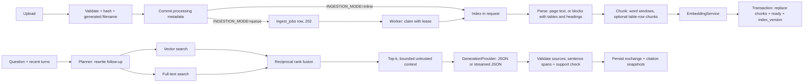

# Architecture

## Boundaries and data flow

The browser owns presentation and cache state (TanStack Query); it never sees a provider key. FastAPI routers validate transport schemas, repositories apply relational scope, services coordinate work, and `rag/`, `retrieval/`, `answer/`, `ingest/` and `providers/` hold replaceable boundaries.

Every chat request is traced (`app/observability/trace.py`): per-stage milliseconds, token counts,
model load time and candidate ids with scores per retriever. Traces contain no question or
document text and are logged as one `rag_trace` JSON event.

## Schema

- Workspace: UUID, name, timestamp.
- Document: workspace FK, original display name, opaque storage name, MIME, bytes, SHA-256, state, page count, chunk count, embedding model, `index_version` (parser, chunker and embedding model the chunks were built with), timestamps, safe error text.
- DocumentChunk: document FK with cascade, sequence, optional page, text, metadata JSONB (strategy, section path for structure chunks), vector(1024), and two generated `tsvector` columns (`english`, `simple`) with GIN indexes (migration `r1_fts`).
- IngestJob (`r3_ingest_jobs`): document FK, kind (ingest/reindex), status, attempts and maximum, stage and progress, `run_after`, lease owner and expiry, last error. A partial unique index allows one unfinished job per document.
- Conversation: workspace FK, title, timestamp.
- Message: conversation FK with cascade, role, content, citation snapshots, and sentence-level citations (`r2_sentences`).

Uniqueness on (workspace_id, sha256) is the race-safe duplicate barrier. There is no HNSW index: exact vector search keeps recall and filter semantics exact at this scale (vector search measured 14 ms p50 over about 400 chunks). Migrations after `0002` use `r*` ids so they chain cleanly.

## Ingestion

Uploads are bounded twice (HTTP body and file bytes), checked for extension, MIME and file signature, and stored under a generated name. Metadata commits as `processing` before parsing.

`IngestionService.index` parses and chunks in a thread pool, embeds, then in one transaction deletes any earlier chunks of the document, inserts the new ones and marks it `ready` with its `index_version`. Replacing chunks makes retries and reindexing idempotent.

Two modes:

- **inline** (native development default): the upload request does all of it, as before.
- **queue** (Compose default): the upload returns 202 with the document and its job. `python -m app.worker` claims jobs with `SELECT ... FOR UPDATE SKIP LOCKED`, holds a lease it renews on every progress update (parsing, then embedding in batches of 32), and marks the job succeeded. Transient failures (for example the model is not loaded) retry with backoff of 5 s, 10 s, 20 s... capped at 5 minutes; unparseable files fail at once. If a worker dies, its lease expires and another worker reclaims the job; after `JOB_MAX_ATTEMPTS` the job and document are marked failed. `POST /workspaces/{id}/reindex` queues every ready document whose `index_version` differs from the current settings.

Database deletion cascades chunks and jobs, then removes the original file. Database and filesystem are not one transaction; a future outbox/garbage collector should close that gap.

## Parsing and chunking

- **words** (default): PyMuPDF page text (`sort=True`), DOCX paragraphs and table rows, TXT; NFKC normalisation; 350-word windows with 50-word overlap inside each page.
- **structure**: `app/ingest/structure.py` reads PyMuPDF's layout: tables via `find_tables()` rendered as one "Header: value; ..." line per row (multi-row headers, merged cells and wrapped rows are repaired), vertical text dropped (removes side watermarks), running headers and footers that repeat across pages dropped, headings detected by size, weight and numbering, and the content-stream block order kept (two-column pages stay in column order). Chunks of about 260 words never cross a heading or a page and start with their heading path.
- **words_tables**: the default word windows plus extra chunks holding each detected table's rows with its heading and caption.

Structure chunking fixed table extraction (for example the SP 800-40r4 matrix row that the page-text parser garbled) but lowered recall on prose questions in the test split, so it is not the default. See docs/EVAL_RESULTS.md for each strategy's measured effect.

Scanned pages with no text layer still fail with "OCR is required". OCR needs a model download that has not been approved yet.

## Retrieval

`build_retriever` returns `retrieval_depth` (20) ranked chunks; the generator sees the first `top_k` (6).

- **Hybrid** (default): vector cosine search and PostgreSQL full-text search (`english` configuration, question terms OR-ed, `ts_rank_cd`) each produce 30 candidates; reciprocal rank fusion with k=60 merges them. An optional third list matches identifier tokens ("800-61r3", "HC-412") as exact phrases on the `simple` configuration; it is off because it did not help on the dev split.
- **Metadata filters** (`RetrievalFilters`): document ids, file types and page range, applied inside every candidate query so filtered-out chunks never take a slot. Page filters keep unpaginated DOCX/TXT chunks.
- **Query planning** (`app/retrieval/query.py`): when a conversation has history, one schema-constrained model call rewrites the latest question into a standalone question (about 1 s, about 370 prompt tokens). Splitting multi-part questions into fused sub-queries exists but is off by default (`QUERY_DECOMPOSITION`) because it hurt in the one measured case. A planner failure falls back to the original question.

There is no global similarity cutoff: scores are rank signals, not calibrated confidence (DECISIONS #16).

## Generation and citations

The context is JSON under `untrusted_context`; document text never becomes a system message. The provider returns schema-constrained JSON.

- **answer** format (default): `{answer, source_ids, insufficient_context}`. Unknown source ids are rejected; a supported answer must cite something.
- **sentences** format: passages are labelled S1..Sn and the model returns `{sentences: [{text, source_ids}], insufficient_context}`. For every sentence the API finds the one or two source sentences that share most content words (character span, highlighted in the UI) and runs a lexical support check: every number, code or date in the sentence must appear in the cited passages and at least half its content words must too. Unsupported sentences are flagged, not hidden. This check catches wrong numbers but not paraphrased contradictions; an NLI verifier is the planned replacement.

`POST /chat/stream` returns Server-Sent Events: `stage` (planning, retrieving, generating, verifying), `delta` (provisional text decoded from the partially streamed JSON, shown dimmed), `final` (the validated response, same shape as `/chat`) and `error`. The exchange is saved only after a successful `final`. Providers without streaming (OpenAI adapter) send only `final`.

## Conversations

User/assistant pairs commit together after a successful answer; a row lock serialises turns per conversation. The last `HISTORY_MESSAGES` messages feed the query planner only. Answers still come from retrieved passages, never from earlier answers. Citations are answer-time snapshots; deleting a document does not rewrite history.

## Extension points

- GenerationProvider: `generate`, `generate_structured`, optional `generate_stream`.
- Retriever protocol: vector, hybrid, future reranker stage between fusion and generation.
- Parsing: `parse_blocks` is the place for an OCR or Docling adapter (`OCRProvider` protocol unchanged).
- Support check: `app/answer/citations.check_support` is the place for an NLI verifier.
- FileStorage, identity and authorization as before.

## Operational shape

Compose: PostgreSQL 16/pgvector, API (runs Alembic on start), ingestion worker (same image), Next.js. Ollama runs on the host. Host ports are configurable. Logs are JSON events without questions, passages or filenames.
